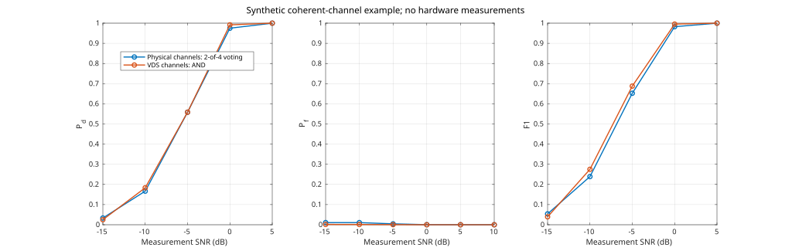

# Cooperative Compressed Spectrum Sensing

Cooperation, virtual data synthesis and bin-level detection in compressed spectrum sensing.

[](https://github.com/LhadjBENZATER/Cooperative-Compressed-Spectrum-Sensing/actions/workflows/validate.yml)
[Paper](https://doi.org/10.1002/ett.70000) · [Download releases](https://github.com/LhadjBENZATER/Cooperative-Compressed-Spectrum-Sensing/releases) · [Researcher website](https://lhadjbenzater.github.io/)

The quick start compares 2-of-4 voting on independently reconstructed physical channels with AND fusion on leave-one-out VDS channels. Both use the same synthetic measurements and OMP recovery.

## Run the example

Download and extract the latest release, or clone:

```bash
git clone https://github.com/LhadjBENZATER/Cooperative-Compressed-Spectrum-Sensing.git
cd Cooperative-Compressed-Spectrum-Sensing
```

Open MATLAB in this directory and run:

```matlab
result = demo_ccss;
```

The example generates its inputs and needs no private files or SDR hardware.
It writes `results/demo_metrics.csv`, `results/demo_results.mat` and
`docs/preview.svg`. The SVG can be opened in a browser. For numerical output
without plotting, run `result = demo_ccss(false);`.

The new example uses base MATLAB only. MATLAB R2017b or later is recommended.
CI runs the numerical checks and plotting example in **MATLAB R2024a on Linux**.
The measured elapsed time and actual runtime version appear in
[the validation log](docs/validation.txt). Runtime depends on hardware and
MATLAB release. GNU Octave compatibility has not been established.



## Model, assumptions and interpretation

`Y = A X + W`, with a 64 × 128 unit-column-norm Gaussian dictionary,
6 active bins and 4 coherent equal-gain channels. The seed is `20261121`;
there are 20 paired trials per SNR from −15 to 10 dB in 5 dB steps.
Complex independent AWGN is scaled using the clean compressed-measurement power.
Each channel uses K-step OMP (`somp_baseline` with one vector).
The physical-channel detector is explicitly **2-of-4** voting, including a tie.
The transformed-channel detector requires all four local decisions.

VDS averages all other channels for each output. Under these coherent,
independent-noise assumptions its marginal noise variance is reduced by L−1;
the transformed outputs are correlated. Different signal phases/fading can
change this behavior. Neither detector is calibrated to a fixed Pf here.

Bin scoring uses TP, FP and FN with **no guard bins or frequency tolerance**:
`Pd = TP/K`, `Pf = FP/(N-K)`, and `F1 = 2TP/(2TP+FP+FN)`.
The detector's support-cardinality policy is described above.

The new example is a reproducible onboarding experiment, **not a reproduction
of the paper's full numerical campaign or hardware measurements**. The legacy
scripts remain available with their original names.

## Files and historical experiments

| Files | Purpose / prerequisites |
|---|---|
| `Pd_Pfa_Vs_SNR.m`, `Pd_Pfa_Vs_L.m` | Historical sweeps; require waveform, sensing-matrix and recovery helpers absent from this repository. |
| `Combined_view.m`, `Virt_X.m` | Historical spectrum/cooperation plots; require `WFG_Re`, `Phi_selection`, `Virtual`, `fct_RMP` and other external helpers. |
| `fct_Cooperat.m` | Historical fusion/scoring helper, uses `medfilt1` (Signal Processing Toolbox). |
| `Pd_SNR_ED.m` | Energy-detection expression; check its statistical/toolbox dependencies before use. |
| `x.dat` | Retained historical data file; the generated quick-start demo does not load it. |

The current public implementation is **MATLAB**. No Python implementation,
GNU Radio flowgraph or complete USRP acquisition application is included.

See [the dependency inventory](docs/LEGACY_DEPENDENCIES.md) before running older
scripts. The new example deliberately avoids those external dependencies.

## Validation

```matlab
addpath tests
run_tests
run_validation
```

`run_validation` runs numerical checks, the demo, and the figure export. GitHub
Actions preserves CSV/MAT outputs as an `example-results` artifact and records
the preview and validation log after a successful main-branch run. The CI badge
reports execution status; it is not a certification of the paper's conclusions.

## Citation

Associated publication: **Enhanced Cooperative Compressive Spectrum Sensing in Cognitive Radio Networks**, Transactions on Emerging Telecommunications Technologies, 35(11), e70000, 2024.
DOI: [10.1002/ett.70000](https://doi.org/10.1002/ett.70000).

Use GitHub's **Cite this repository** control for citation metadata. Cite the
paper when discussing its method, and identify the software release/commit
when reporting results from this code. Paper authorship and software-maintainer
metadata are distinguished in [CITATION.cff](CITATION.cff).

## Questions and contributions

Open an issue with your MATLAB version, command, parameters and full error.
See [CONTRIBUTING.md](CONTRIBUTING.md). Research enquiries:
[Hadj Abdelkader Benzater — EMP](https://lhadjbenzater.github.io/).

## License

Author-contributed code is available under [MIT](LICENSE).
Retain copyright and attribution notices when reusing the code.
